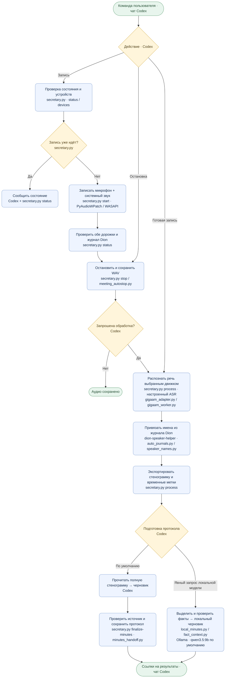

# Dion Secretary — схема работы

- Автоостановка: закрытие привязанного окна встречи или всего Chrome. Закрытие вкладки и признаки окончания встречи дают только предупреждение.
- После старта проверяются работа аудиопроцесса, поступление данных в обе дорожки и свежесть журнала Dion. Недоступный журнал не блокирует запись; имена остаются неподтверждёнными.
- Запись сохраняется независимо от обработки. Напоминания: через 60 минут, затем каждые 30 минут — `recording_reminders.py`.
- При ошибке Codex сообщает этап и известную причину; частичные записи и готовая стенограмма сохраняются. Движок распознавания и способ подготовки протокола автоматически не подменяются.
- Whisper и разделение по голосам включаются только по явному запросу. Основная схема показывает режим имён из журнала браузера.

Источник: [SKILL.md](SKILL.md). Схема сверена с инструкцией 2026-10-27.
- Выходные каталоги задаются параметрами sessions и notes. Настройки компьютера находятся в исключённых из Git config.json и references/local.md.
- GigaAM-v3 использует gigaam_worker.py, Whisper — faster-whisper. Движок задаётся настройками; автоматического переключения нет.
